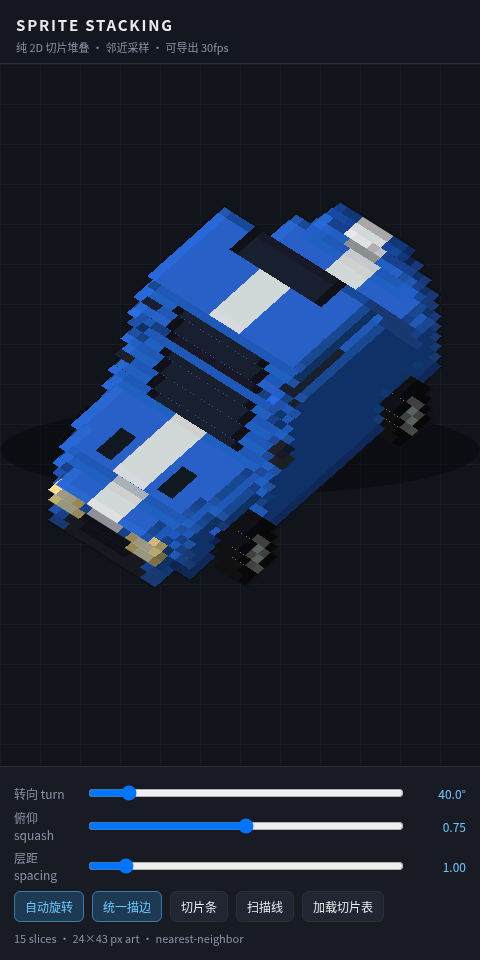
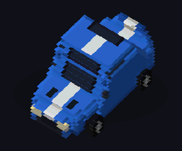

# Sprite Stacking Demo / 精灵堆叠演示

A small, self-contained demo of **sprite stacking**: a way to give flat 2D
pixel art a 3D-like turn without a 3D renderer. The repository includes an
interactive browser engine, a procedural 15-slice voxel car, a Python
nearest-neighbor renderer, and a tool that carves a slice sheet from four
orthographic views.

这是一个独立的**精灵堆叠（Sprite Stacking）**演示：用纯 2D 像素切片做出可转向的
3D 感，而不走 3D 渲染。仓库里有可交互的网页引擎、一辆 15 层程序化体素小车、
邻近采样的 Python 渲染器，以及从四视图雕刻切片表的脚本。





## What is sprite stacking? / 什么是精灵堆叠

A **slice sheet** is a horizontal strip with one top-down slice per pixel of
height. To draw the object you lift slice *z* by `round(z * spacing)` pixels
(usually 1) and rotate **every** slice by the same angle around its center.
A vertical squash of about `0.75` stands in for camera pitch. Use
nearest-neighbor sampling and whole-pixel positions so the result stays
crisp; outline the finished stack once, not each slice; bake static props
into a single sprite.

**切片表**是一条横向长图，物体高度上的每一像素对应一层自上而下的切片。绘制时，
把第 *z* 层抬高 `round(z * spacing)` 像素（通常是 1），并让**所有**切片绕中心转
同一个角度。纵向压扁约 `0.75` 用来模拟镜头俯仰。用邻近采样和整像素坐标，画面才
会保持硬边；描边要画在整叠完成之后，而不是每一层上；静止物体可以预绘成一张精灵图。

The bundled car is 24×43×15 voxels (width × length × height) and is written
left-to-right into `code_car_slices.png`, ground slice first.

仓库里的小车是 24×43×15 体素（宽 × 长 × 高），按从地面到顶部的顺序从左到右写入
`code_car_slices.png`。

## Interactive demo / 交互演示

The static files are ready for GitHub Pages. A repository admin needs to turn
the site on once: Settings → Pages → Deploy from a branch, branch `main`,
folder `/ (root)`. The address will be:

静态文件已经放在仓库根目录。仓库管理员还需要打开一次：Settings → Pages →
Deploy from a branch，分支选 `main`，目录选 `/ (root)`。地址将是：

https://h1bomb.github.io/sprite-stacking-demo/

To run it locally, serve the repository root over HTTP (opening the file
directly may block the JSON metadata request) and open `demo.html`:

请从仓库根目录用 HTTP 打开（直接用 `file://` 打开时，浏览器可能拦掉切片元数据的
`fetch` 请求）：

```bash
python3 -m http.server 8000
```

Then visit http://127.0.0.1:8000/demo.html

You can turn the stack, change squash and slice spacing, toggle a unified
outline, show the slice strip or a scanline, and load your own sheet with
「加载切片表」. The page first looks for `code_car_slices.png` next to
`demo.html`, then `code_model/code_car_slices.png`, then `slices.png`.

页面里可以转向、调整俯仰压缩和层距、开关统一描边、显示切片条或扫描线，也可以用
「加载切片表」打开自己的切片图。默认会依次尝试同目录下的 `code_car_slices.png`、
`code_model/code_car_slices.png` 和 `slices.png`。

## Python tools / Python 工具

```bash
python3 -m pip install -r requirements.txt
```

### Regenerate the car slice sheet / 重新生成小车切片表

```bash
python3 make_voxel_car.py
```

Writes `code_car_slices.png` and `code_car_slices.json` in the current
project root, plus magnified previews under `code_model/`. Pass `--outdir`
to write somewhere else:

会在项目根目录写出 `code_car_slices.png` 和 `code_car_slices.json`，并在
`code_model/` 下生成放大预览。可用 `--outdir` 改输出位置：

```bash
python3 make_voxel_car.py --outdir /tmp/car-slices
```

### Render stills or a clip / 渲染静帧或短片

```bash
python3 render_stack.py code_car_slices.png --stills /tmp/stills
python3 render_stack.py code_car_slices.png --out /tmp/stack.mp4
```

`--stills` exports a few camera poses (three-quarter, side, exploded, and so
on). `--out` optionally builds a 12-second 9:16 demonstration with ffmpeg
(not required to use the rest of the project). Sampling is nearest-neighbor;
slice positions are rounded to whole pixels.

`--stills` 会导出几个常用机位（3/4 侧、正侧、爆炸视图等）。`--out` 可选用 ffmpeg
导出一段 12 秒的 9:16 演示（不是使用其他功能的前提）。采样为邻近采样，切片位置取整到像素。

### Carve slices from four views / 从四视图切出切片

```bash
python3 slice_from_views.py views.png out_slices.png --shade 0.25 --debug /tmp/slice-debug
```

The input should be a single image with four orthographic drawings: top,
side, front, and back. The script keys the background, snaps soft pixels to
a grid when needed, and carves a slice only where the views agree. Use
`--debug` to dump the detected views and the resulting sheet.

输入应是一张包含俯视、侧视、前视、后视四个正交视图的图。脚本会抠掉背景，必要时把
发糊的像素对齐到网格，并且只在各视图一致的位置留下体素。加 `--debug` 可以导出检测到的
视图和结果切片表。

## Algorithm notes / 算法说明

Draw order follows the SpriteCook formulation (art pixels, then scale):

绘制顺序按 SpriteCook 的写法（先在美术像素里计算，再缩放）：

```
translate(pos)
  * translate(0, -round(z * spacing * scale))
  * scale(1, squash)
  * rotate(turn)
```

In other words: rotate first, squash on Y for camera pitch, then lift the
slice. A typical squash is `0.75`; spacing is usually `1`.

也就是：先旋转，再按俯仰在 Y 方向压扁，最后抬高该层。俯仰压缩常用 `0.75`，层距通常为 `1`。

Four-view carving (the SpriteCook / “SpriteCook algorithm” idea): each row
of a side view becomes one slice. A voxel is solid only where the top view
and the corresponding row of the side, front, and back views all contain a
pixel. This method cannot produce internal holes or overhangs; author those
by painting the slice sheet directly, or export slices from a true voxel
model (as `make_voxel_car.py` does).

四视图雕刻（SpriteCook 算法）：侧视的每一行对应一层切片。只有俯视图，以及侧视、前视、
后视在同一高度的行里都有像素时，该体素才存在。这种方法做不出内部空洞或悬挑；那些形状
需要直接画切片表，或像 `make_voxel_car.py` 这样从真正的体素模型导出。

Practical tips:

实战建议：

1. Outline the completed stack, not every slice.
2. Round lifts and blit positions to integer pixels; keep nearest-neighbor sampling.
3. Bake stacks that never turn or move into one sprite.

1. 整叠完成后再描边，不要逐层描。
2. 抬高和绘制坐标取整，始终用邻近采样。
3. 不会转动或移动的物体，预绘成一张精灵图即可。

## Repository layout / 目录说明

| Path | Contents |
| --- | --- |
| `demo.html` | Interactive engine |
| `make_voxel_car.py` | Procedural voxel car → slice sheet |
| `render_stack.py` | Nearest-neighbor stack renderer |
| `slice_from_views.py` | Four-view sheet → slice sheet |
| `code_car_slices.png` / `.json` | Bundled 15-slice car |
| `code_model/` | Same sheet, magnified preview, and stills |
| `preview/` | Screenshot and spin GIF of this demo |

## Credits / 致谢

See [CREDITS.md](CREDITS.md). The technique is inspired by work from Kimo
([@asynkimo](https://x.com/asynkimo)), Rehan Sheikh
([@rehan_shei](https://x.com/rehan_shei) / [moon-stack](https://patch.gg/rehan/moon-stack)),
and the [SpriteCook sprite-stacking guide](https://www.spritecook.ai/blog/sprite-stacking-pixel-art).
Their original artwork is **not** included here.

手法受 Kimo、Rehan Sheikh 与 SpriteCook 教程启发，详见 [CREDITS.md](CREDITS.md)。
本仓库不含他们的原画或视频。

## License / 许可

[MIT](LICENSE) © 2026 QIqiZhou
